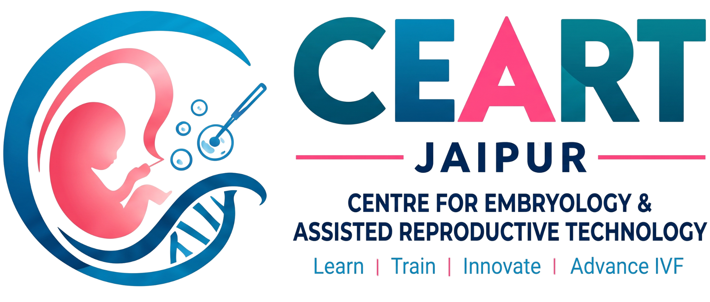

# CEART — Centre for Embryology & Assisted Reproductive Technology

A modern, responsive, ultra-premium single-page website for **CEART** (Centre for Embryology & Assisted Reproductive Technology), India's premier clinical embryology and reproductive medicine training institute.



---

## 🔬 Overview

This website serves medical doctors, gynecologists, embryologists, and life science scholars seeking advanced hands-on training in Assisted Reproductive Technology (ART), ICSI, cryopreservation, and clinical IVF laboratory management.

### ✨ Key Features & Highlights

- **24 Comprehensive Sections**:
  1. Top Bar (Emergency contact & direct registration)
  2. Sticky Glassmorphism Header (`backdrop-filter: blur(16px)`)
  3. Hero Section with subtle parallax background and live counter stats
  4. Partner IVF Clinics & Hospitals strip
  5. About Us split layout with animated pulsing sonar badge (`200+ Students`)
  6. Lead Generation Form with floating labels & interactive feedback
  7. Filterable Programs & Courses (Embryology, Clinical ART, Fellowships)
  8. 4-Column Facilities & Infrastructure showcase
  9. Video & Insights with continuous sonar-ripple play button
  10. National & Global Footprint with custom geospatial hub vector
  11. Campus Life & Events masonry gallery with hover reveal overlays
  12. 3-Step Animated Admission Process timeline
  13. Faculty & Senior Mentors profiles
  14. Student Testimonials (Written quotes & Video feedback cards)
  15. Student Placement showcase across leading hospital chains
  16. Key Academic Highlights
  17. 6-Pillar "Why CEART" feature matrix
  18. Career Pathways & High-demand roles cloud
  19. Detailed Curriculum & SEO long-form content with sticky contact card
  20. Full-width Banner CTA
  21. Recent Research Articles & Clinical Guides
  22. Categorized FAQ Accordion (Admission, Courses, Facilities)
  23. Pre-footer Admissions Consultation strip
  24. 4-Column Navy Blue Footer with social links & legal links

- **Refined Color Palette**:
  - Primary Teal: `#1B7A8B`
  - Accent Pink: `#FF3B7C`
  - Navy Blue: `#142F4B` & `#0B1A2B`
  - Soft Cyan: `#3FA9C3`
  - Background: Soft `#F8F9FA` to `#FFFFFF` gradients

- **Interactive Animations (`main.js`)**:
  - `IntersectionObserver` scroll-reveal animations (`data-reveal="slide-up"`, `slide-left`, `slide-right`, `fade-in`)
  - Smooth eased number counters for statistics (`data-counter`)
  - Background parallax scrolling on hero section
  - Frosted glass header transition on scroll
  - Admission timeline connecting line fill animation
  - Interactive course filter tabs and expandable FAQ accordions

---

## 📁 File Structure

```text
├── ceartlogo.png               # Official CEART branding logo
├── index.html                  # Main semantic HTML5 webpage
├── global.css                  # Custom styling, design tokens, and animations
├── main.js                     # Interactive animations, observers, and UI logic
├── README.md                   # Project documentation
└── .gitignore                  # Git ignore rules
```

---

## 🚀 Getting Started

Simply open `index.html` in any modern web browser (Google Chrome, Microsoft Edge, Mozilla Firefox, Safari).

### Local Preview via Python (Optional):
```bash
python -m http.server 8000
```
Then visit `http://localhost:8000`.

---

## 🌐 Deploy to GitHub Pages

1. In your GitHub repository, go to **Settings** > **Pages**.
2. Under **Build and deployment** > **Branch**, select `main` and root `/`.
3. Click **Save**. Your site will be live at `https://pawanharish2-del.github.io/ceartembryology/`.

---

## 📄 License & Attribution

Designed and developed for **CEART Jaipur** (Centre for Embryology & Assisted Reproductive Technology). All rights reserved.
